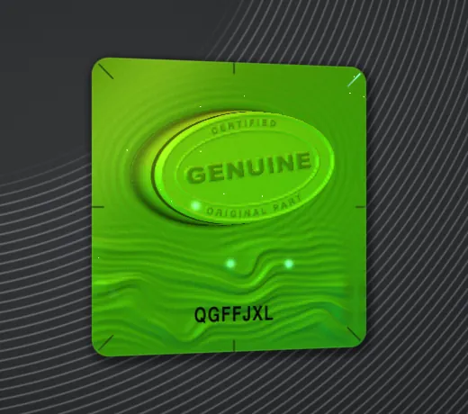

# Holo sticker

A holographic "genuine part" sticker you can tilt. It's one HTML file and one WebGL2 fragment shader, with no build step and no dependencies.

**[Try it live](https://omarhuss.github.io/holo-sticker/)**: move the pointer, drag, or tilt your phone.

<p align="center">
  <a href="https://omarhuss.github.io/holo-sticker/">
    
  </a>
</p>

## How it works

- **One height map.** The coin and its relief are drawn once on a 2D canvas and turned into a height map.
- **Parallax occlusion mapping.** The fragment shader ray-marches that map along the view vector, up to 24 steps per pixel plus a short binary refine, so the coin reads as a thick raised disc with real side walls and not as a flat texture.
- **Three ways to tilt.** The mouse on a desktop, the gyroscope on a phone (HTTPS only), or a touch drag. After three seconds without input it drifts on its own.
- **It idles.** It redraws only when the tilt changes, so the GPU rests while the sticker is still.
- **Reduced motion and lost contexts.** Reduced motion gets a smaller tilt range and no drift, and the scene rebuilds itself after a lost WebGL context.

## Use it

Copy `index.html`, or lift `createHoloSticker` out of it:

```js
const { serial } = createHoloSticker(document.querySelector('canvas'), {
  text: 'GENUINE', // the word on the coin, up to 16 letters or digits
  seed: 22,        // same seed, same sticker and serial
});
```

| Option | What it does |
| --- | --- |
| `text` | The word on the coin. Defaults to `GENUINE`. |
| `seed` | A number. The same seed draws the same sticker and serial. |
| `tilt` | `[x, y]`, each from -1 to 1. Renders one still at that tilt and stops. |
| `reducedMotion` | Smaller tilt range and no idle drift. |
| `tiltButton` | A button to show on iOS, where motion access needs a tap. |
| `onSource(name)` | Called with `mouse`, `touch` or `gyro` when the input changes. |

The demo page reads `text`, `seed` and `tilt` from the URL: [`?text=OMAR&seed=7`](https://omarhuss.github.io/holo-sticker/?text=OMAR&seed=7).

## On a phone

The gyroscope only works over HTTPS. iOS also asks for motion access, and only after a tap, so the page shows an "Enable tilt" button there. If access is refused, dragging still works.
